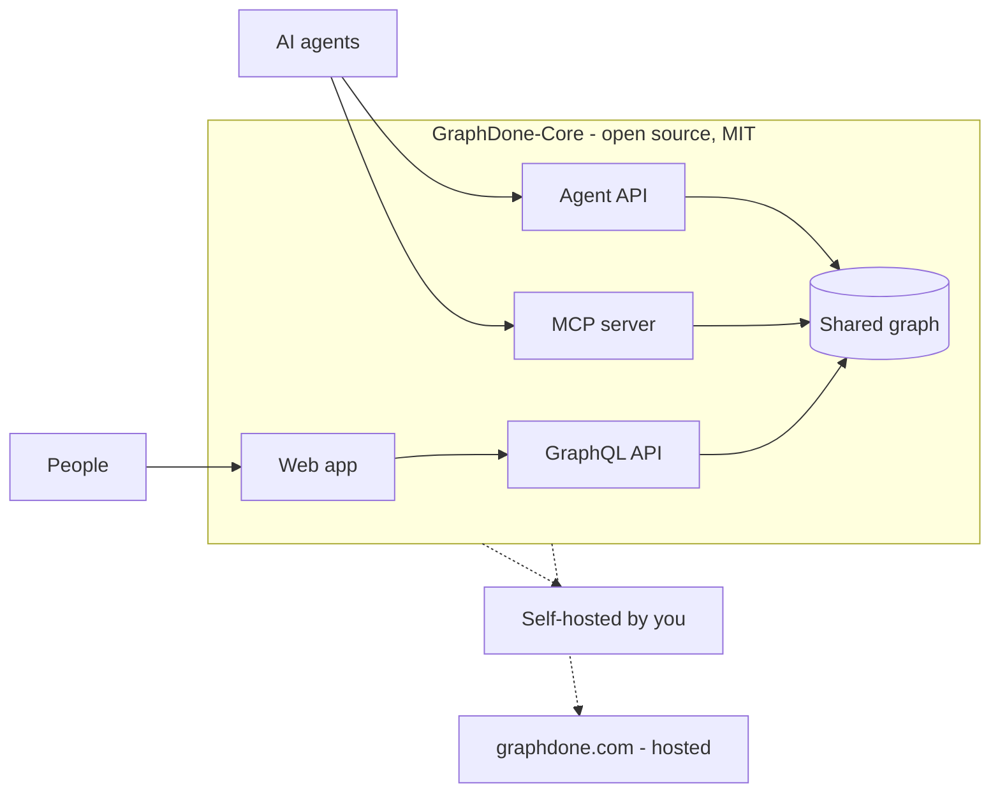

<picture>
  <source media="(prefers-color-scheme: dark)" srcset="img/hero/graphdone-dark.svg">
  
</picture>

GraphDone is one graph of work that people and AI agents share. Work items, the people and agents who own them, and the dependencies between them all live in one graph, and the work converges on outcomes instead of flowing down a hierarchy. Agents are peers in that graph: they read and change it through an MCP server and an agent API, just as people do through the web app.

## How it fits together

- **GraphDone-Core** is open source (MIT): a React web app, a GraphQL API and an MCP server for AI agents. You can self-host it. An agent API is in development on its `dev` branch.
- **graphdone.com** is the hosted app, built on Core. It runs on Cloudflare: Pages for the web app, Workers for the API, and D1 (SQLite) for the graph. A private hosted layer adds hardened sign-in, enrollment, sharing and usage limits.
- **People and AI agents** work in the same graph: people through the web app, agents through the MCP server and the agent API. Each of these reaches the graph on its own path; the MCP server and the agent API do not go through GraphQL.
- Deployment and test automation and the landing site are maintained privately.

## Meet the Founders

### Matthew Valancy
**Co-Founder, Engineer**

  

*From Silicon Valley, California, Matthew has worked with engineering teams across every startup phase—from garage startups to IPO. He's observed that the most talented engineers are often self-directed individuals who thrive with autonomy, yet most management approaches are designed for workers who need constant oversight. GraphDone emerged from his belief that passionate, independent contributors deserve tools that amplify their strengths rather than constrain them.*

---

### Lakshman Patel
**Co-Founder, Engineer** 

  

*From a farming family in India that taught him hard work and seizing opportunities can transform lives, Lakshman brings that relentless drive to building technology. He champions rapidly adopting cutting-edge tools and methodologies to accelerate learning, continuously iterate on solutions, and deliver exceptional end-to-end experiences that exceed expectations.*

## Get started

- **[graphdone.com](https://graphdone.com)**: the hosted app.
- **[GraphDone-Core](https://github.com/GraphDone/GraphDone-Core)**: the open-source web app, GraphQL API and MCP server, to run yourself. The one-line installer is broken until [GraphDone-Core#243](https://github.com/GraphDone/GraphDone-Core/issues/243) is fixed; until then, follow the manual installation steps in its README.
- **[Documentation](https://github.com/GraphDone/GraphDone-Core/tree/main/docs)**: guides and technical reference.

**Tech stack:** TypeScript, React, Node.js, GraphQL and MCP. graphdone.com runs on Cloudflare Pages, Workers and D1 (SQLite). Self-hosted Core runs with Docker; its graph store is Neo4j today, and [GraphDone-Core#244](https://github.com/GraphDone/GraphDone-Core/issues/244) plans SQLite as the default.

**License:** MIT, for GraphDone-Core.

---

*Started by Matthew Valancy & Lakshman Patel*
